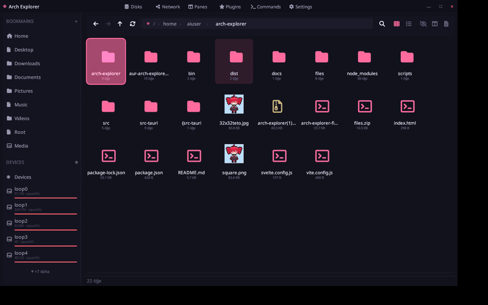
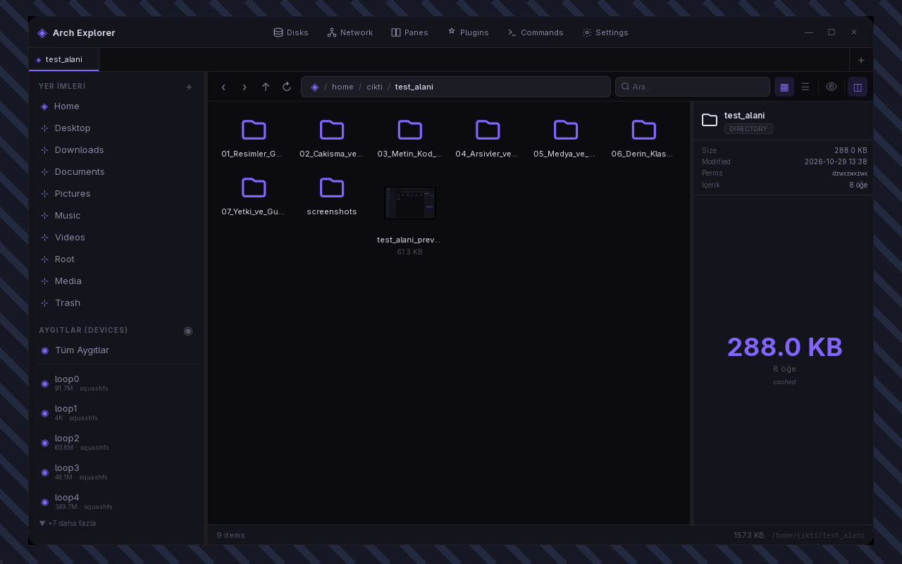
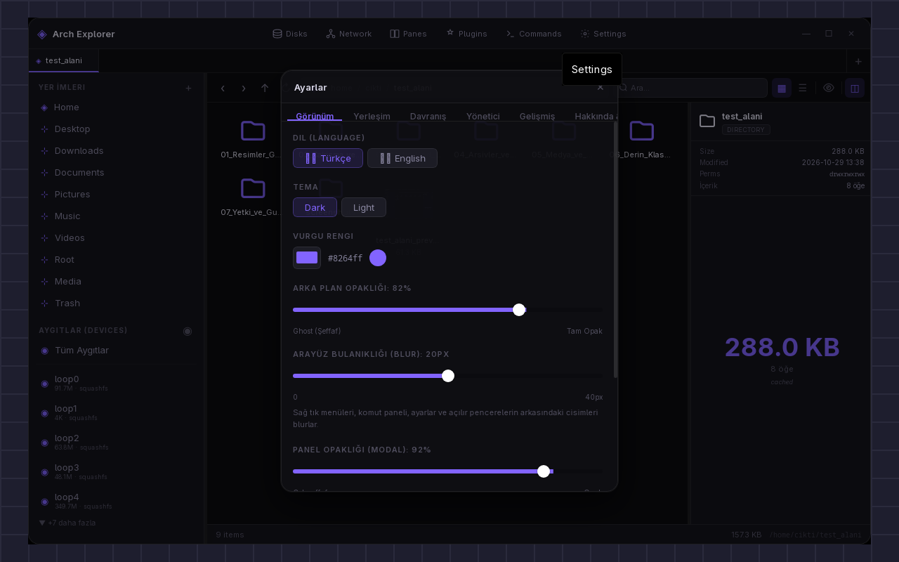
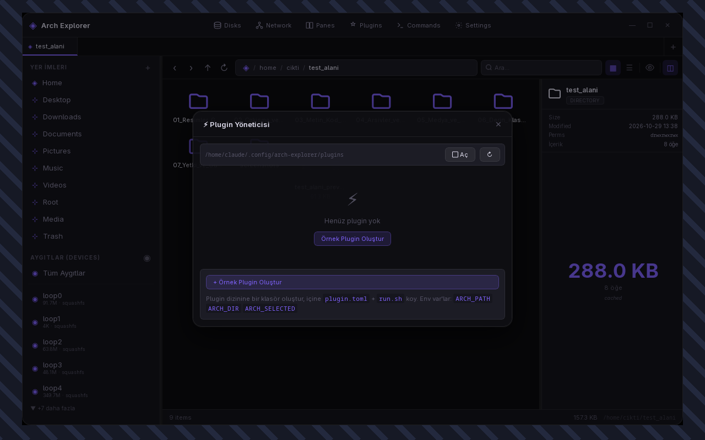
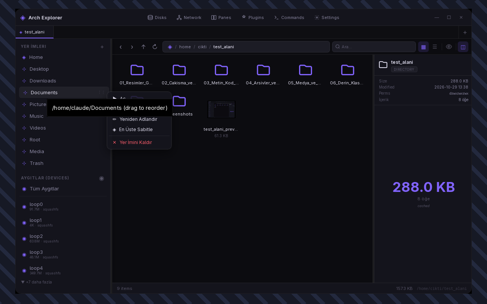

# ◈ Arch Explorer (v2 Native)

<p align="center">
  
</p>

<p align="center">
  <strong>Blazing fast, ultra-lightweight, hardware-accelerated native file manager for Arch Linux & Wayland.</strong><br>
  Built with Pure Native Rust + egui + wgpu · Zero WebKit bloat · ~45MB RAM · True Desktop Glassmorphism
</p>

<p align="center">
  
  
  
  
</p>

---

## ⚡ Direct Download & Instant Run (No `cargo build` Needed!)

You don't need to install Rust or wait for compilation! A standalone precompiled binary and native Arch Linux package are included right in the repository:

### 1. Instant Run (No Installation Required):
```bash
git clone https://github.com/basihamam/arch-explorer-eguine.git
cd arch-explorer-eguine
chmod +x ./bin/arch-explorer
./bin/arch-explorer
```

### 2. Native Arch Linux Install (pacman):
```bash
sudo pacman -U bin/arch-explorer-bin-0.2.0-2-x86_64.pkg.tar.zst
```

### 3. AUR (Arch User Repository):
```bash
yay -S arch-explorer-bin
# or: paru -S arch-explorer-bin
```

---

## 🚀 Building From Source (For Developers)

If you prefer building from source, all dependencies and patched Wayland modules are self-contained in `crates/winit`:

### Prerequisites (Arch Linux):
```bash
sudo pacman -S --needed rustup base-devel wayland wayland-protocols libxkbcommon gtk3 hicolor-icon-theme
```

### Build & Run:
```bash
git clone https://github.com/basihamam/arch-explorer-eguine.git
cd arch-explorer-eguine
cargo run --release
```
*The optimized binary will be produced at `target/release/arch-explorer`.*

---

## ✨ Features at a Glance

- **⚡ Blazing Fast & Featherweight:** Consumes only ~40–50 MB RAM with instant startup (<50ms). Pure GPU rendering via `wgpu`.
- **🎯 Native Wayland Drag & Drop (`wl_data_device`):**
  - Outgoing drag renders a 64×64 neon-bordered thumbnail/icon surface directly attached to the Wayland cursor.
  - Seamless two-way drag and drop with **Nemo, Nautilus, Firefox, Chromium, Discord, and desktop workspaces**.
  - **Self-drop isolation:** Cancelling or releasing files back into the same window never triggers false "external drop" notifications or redundant file copies.
  - **Clipboard isolation:** Drag-and-drop does not overwrite your system clipboard (<kbd>Ctrl+C</kbd> / <kbd>Ctrl+X</kbd> remain intact).
- **🪟 True Desktop Transparency & Glassmorphism:** Real alpha-channel compositor pass-through. Looks stunning with Hyprland and Sway blur filters.
- **📁 Dual-Pane & Multi-Tab System:** Split-screen navigation with independent browsing contexts and persistent sessions (`~/.config/arch-explorer/session.json`).
- **💻 Integrated Terminal Drawer:** Toggleable terminal drawer at the bottom of the window for rapid CLI tasks in the current directory.
- **👁 Rich File Previews:** Media inspection with syntax highlighting for code/text, image viewer, and integrated video playback.
- **📱 ADB Device Manager:** Direct browsing and file transfers with connected Android devices over USB / Wi-Fi.
- **🎨 AEX Live Theming:** Fully modular color palettes, border radius controls, and real-time JSON/AEX theme switching.

---

## 📸 Visual Showcase

### Glassmorphism & Desktop Transparency
Arch Explorer lets your wallpaper and system theme shine through with hardware-accelerated blur and customizable opacity sliders.

<p align="center">
  
</p>

### Settings & Appearance Customization
Live theme presets, accent color picker, interface blur (0–40px), and background opacity controls.

<p align="center">
  
</p>

### Layout & Folder Preview Controls
Configurable preview modes (Always, Automatic, Manual, Custom) and one-click toggle for Folder Previews.

<p align="center">
  
</p>

### Clean Context Menu & Trash Management
Quick actions, archive extraction, checksum verification, open-with manager, and trash restore.

<p align="center">
  
</p>

---

## 🪟 Hyprland Blur & Transparency Setup

To enable true glassmorphic blur in Hyprland, add these window rules to your `~/.config/hypr/hyprland.conf`:

```ini
windowrulev2 = opacity 0.88 0.82,       class:^(arch-explorer)$
windowrulev2 = rounding 12,             class:^(arch-explorer)$
windowrulev2 = noshadow,                class:^(arch-explorer)$
windowrulev2 = animation popin 80%,     class:^(arch-explorer)$
```

---

## 🤝 Upstream Contribution
The custom Wayland data device backport patch implemented for `winit 0.30.13` is available in [`patches/winit-0.30.13-wayland-dnd.patch`](patches/winit-0.30.13-wayland-dnd.patch) for upstream `rust-windowing/winit` reference.

---

## 📄 License
Licensed under the [MIT License](LICENSE).
